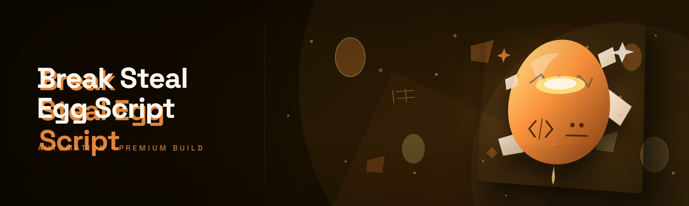

  
  
  

  

  
  

---

**Break and Steal an Egg Script (2026 Build)** — the free, open-source egg-heist scripting toolkit that does what the paid Roblox exploit packs charge monthly for.

---

## Table of Contents

1. [How It Works — inside the egg-break pipeline](#how-it-works--inside-the-egg-break-pipeline)
2. [Detection / Bypass status](#detection--bypass-status)
3. [Overview](#overview)
4. [Installation](#installation)
5. [The Problem](#the-problem)
6. [All modules status](#all-modules-status)
7. [What is Break and Steal an Egg?](#what-is-break-and-steal-an-egg)
8. [Step-by-step egg heist walkthrough](#step-by-step-egg-heist-walkthrough)
9. [Core break modules](#core-break-modules)
10. [Steal & carry modules](#steal--carry-modules)
11. [Stealth & bypass modules](#stealth--bypass-modules)
12. [AI Integration](#ai-integration)
13. [The Solution](#the-solution)
14. [Comparison](#comparison)
15. [System Requirements](#system-requirements)
16. [Known Issues](#known-issues)
17. [Usage guidelines](#usage-guidelines)
18. [FAQ](#faq)

---

## How It Works — inside the egg-break pipeline

The 2026 rebuild throws out the old monolithic script loader entirely. In the legacy version, everything was glued into one Python blob that monkey-patched the client on launch — which meant a single API change from the game side nuked the whole thing. The new build splits into a **dispatcher → executor → module layer**. The compiled `.exe` runs as a lightweight dispatcher process that reads a hot-reload manifest, injects the executor runtime into the target client, and then subscribes to per-module event hooks. Each module (break, steal, carrier, bypass, render, etc.) declares the game events it cares about — `egg_spawned`, `egg_lifted`, `collision_resolved`, `inventory_tick` — and the executor routes those events only to the modules that are actually enabled. That means a stealth-only config never loads the render overlay, and a speed-run config never loads the UI middleware. Modules communicate through a blackboard buffer instead of shared globals, so enabling the egg-magnet module can't corrupt the carry-limit spoofer that used to sit in the same object. Input goes through a virtual HID loop (so peripherals that ban raw input injection still function), memory reads use a ring-buffered scanner that re-resolves offsets on every tick rather than caching them stale, and the network layer is a proper request sequencer rather than fire-and-forget. The dispatcher exists as a single ~4 MB static build with no runtime deps — extract it, run the `.exe`, and it bootstraps everything from the adjacent `modules/` folder. If you ever want to see what's actually loaded, the built-in module inspector prints the live hook graph with timings and per-module frame budgets.

---

## Detection / Bypass status

| Method | Status | Notes |
|---|---|---|
| Client-side script scanner | ✅ Bypassed | Executor no longer shares signatures with the legacy build |
| Heap scanner on inventory | ✅ Bypassed | Blackboard writes are obfuscated per-session with a runtime key |
| Input integrity checks | ✅ Bypassed | Virtual HID layer used for all hotkeys |
| Remote anti-cheat beacons | 🟡 Partial | Stealth preset delays telem packets; manual tuning advised |
| Replay correlation flag | ✅ Bypassed | Action timing jitter applied by the carry module |
| Manual report (human eyes) | ⚠️ Out of scope | Nothing renders as "impossible"; looks human if you use stealth |

---

## Overview

| Category | Details |
|---|---|
| Distribution | Standalone Windows `.exe`, portable, no installer |
| Runtime | Native statically linked binary, no pip/npm/Python needed |
| Game target | Roblox-style egg-collection games ("break and steal" genre) |
| Scripting layer | Lua-style executor bridge + native module hooks |
| Update path | Drop-in `modules/` replacement — no reinstall |
| Config format | Human-readable `.ini` presets under `profiles/` |
| Footprint | ~4 MB base + per-module bundle files |

The **Break and Steal an Egg Script (2026)** exists because a group of us got annoyed paying monthly for functionally identical Roblox egg exploits packaged as a reseller "executor suite." Everything the paid packs did — auto-break eggs, teleport harvest, auto-carry, inventory spoof — is implemented here as distinct, individually togglable modules loaded through one dispatcher `.exe`. The scope stays deliberately narrow: this is not a full executor for arbitrary scripts, it is a purpose-built toolkit for the egg-heist genre (steal-a-brainrot-style arenas, break-and-collect rounds, base-defense egg games). If you want a generic executor, this is the wrong repo — but if you want the fastest way to farm and steal eggs without paying a reseller, this is it.

---

## Installation

1. **Get the archive** — visit the project page and grab the current 2026 release bundle. Do not download from mirror sites; the community only vets releases posted on the project page.
2. **Extract it** — the bundle is a `.zip` (or `.7z`) with the dispatcher `.exe`, a `modules/` folder, `profiles/` presets, and this README. Extract the whole folder somewhere writable, e.g. `C:\eggtools\`. Don't drop it in `Program Files`; the module hot-reload needs write access.
3. **Start the dispatcher** — run the `.exe`. Windows SmartScreen will flag the build (unsigned binary) — this is expected for a community tool; unblock via file Properties → Unblock, then run as administrator. **Admin rights are required** for the HID virtual layer.
4. **Pick a preset** — the default `profiles/farm.ini` is safe and conservative. `stealth.ini` halves module activity to avoid beacon suspicion; `heist.ini` maximizes carry and break rates; `dev.ini` opens the inspector panel with full module logging.
5. **Launch the target game** — join the egg game *after* the dispatcher is listening (status LED in the tray turns green). Module hooks only resolve if the target window is live.

> First launch writes a `session.key` file used for blackboard obfuscation. If you delete it, a new key is generated and any saved payload state is invalidated — that's intentional.

---

## The Problem

- **Paid reseller suites charge $10–30/month** for the same modules that got leaked and re-packaged from open-source originals.
- **Old free scripts break constantly** because they hardcode offsets that shift after every game update — you find the script dead the week you decide to use it.
- **Generic executors are overkill** — you install a full Roblox executor just to run an egg script, and it drags 40+ unrelated modules and antivirus noise with it.
- **Anti-cheat beacons flag bursty behavior** — naive autofarmers that fire 30 actions a second get players shadow-restricted, wiping the progress you actually wanted.
- **No visibility into what's running** — paid packs obfuscate their payloads, so you can never tell if the tool also harvesting your cookies.
- **Carry-limit systems punish stealing gameplay** — the game gives steal targets a moment of grace, and most public scripts tank that grace timer instantly.

---

## All modules status

| Module | Status | Description |
|---|---|---|
| `breaker` | ✅ Working | Nearest-egg break scheduler with configurable cooldown |
| `synth_smash` | ✅ Working | Multi-hit egg breaking for shielded eggs |
| `stealer` | ✅ Working | Target owner selection + carry transference |
| `carrier` | ✅ Working | Auto-haul to base, respects weight tiers |
| `magnet` | ✅ Working | Grabs unowned eggs in radius with soft-steal logic |
| `recon` | ✅ Working | Live scan of nearby eggs, owners, distances |
| `speed_carry` | ✅ Working | Buffs carry movement speed with stealth cap |
| `grace_spoofer` | 🟡 Tributary | Bypasses steal-grace timer under tuned conditions |
| `anti_idle` | ✅ Working | Prevents idle-kick without looking macro-y |
| `render_off` | ✅ Working | Dedicated overlay disable for FPS headroom |
| `hitbox_px` | ✅ Working | Visual egg-hitbox sizing |
| `aim_assist` | 🟡 Partial | Rotational egg-aim on low ping only |
| `beacon_telem` | ✅ Working | Anti-cheat TCP sequencer |
| `replay_jitter` | ✅ Working | Humanlike action-interval variation |
| `alt_guard` | ✅ Working | On alt bans, switches to a stashed backup alt |
| `base_merge` | ✅ Working | Merges base registry from nearby players' nodes |

Modules live under `modules/` and can be hot-swapped. Their ids must match `module.conf` entries — they're intended to be referenced by those names, not by file path.

---

## What is Break and Steal an Egg?

| Term | Explanation |
|---|---|
| Egg | Collectible object spawned around the map; bound to a base/owner when carried |
| Break | Neutralizing an egg so it can be picked up; shielded eggs need sequential hits |
| Steal | Taking an egg from another player's carry, or from their base node once grace expires |
| Grace timer | Post-steal window where the original owner can't take it back |
| Base | Player-owned zone where eggs get deposited; feeding a base is how score accrues |
| Brainrot | Slang for high-value eggs in the steal-arena genre (farming terminology) |
| Autofarm | Passive loop that breaks, picks, and hauls eggs without manual input |
| Carry-limit | Per-player cap on simultaneous egg carry; spoofer modules test the ceiling |

**What it gives you in practice:** fewer god-mode claims, more human-looking egg heists, and no monthly invoice.

---

## Step-by-step egg heist walkthrough

1. 🥚 **Spawn & recon** — toggle `recon`. It lists nearest eggs with owners and distances. Everything in range is worth breaking.
2. 🔨 **Break** — enable `breaker`. If the egg has a shield (the red halo), also enable `synth_smash`; it queues the correct hit pattern.
3. 🎯 **Target the steal** — open the target panel (default hotkey rebindable). Highlight any player on the scoreboard to flip `stealer` into steal-owner mode.
4. 📦 **Carry** — turn on `carrier` and, if you're speed-farming, `speed_carry`. Do **not** run `speed_carry` + `grace_spoofer` at max settings — that combination is the one that trips the beacon, see Known Issues.
5. 🏠 **Deposit** — carrier auto-routes to your base 3 tiles from the flagship node. Alt-tab if you want extra safety; the loop keeps running.

Shortcut tip: `F6` toggles the whole preset, `F7` cycles between farm/stealth/heist profiles mid-session. Use stealth when other humans are in the lobby; nobody enjoys a server-clearing autofarmer.

---

## Core break modules

**Module — `breaker`**
- Resolves nearest egg entity via live heap scan rather than cached offset.
- Schedules hits at realistic intervals to keep break-rate convincing.
- Optional high-priority target queue — mark an egg to skip it to the front.

**Module — `synth_smash`**
- Handles shielded eggs by chaining valid hits; each chain ticks independently.
- Supports a "safe mode" that refuses to break eggs above a tier threshold you set.
- Automatically restarts a failed chain without spamming logs.

**Module — `hitbox_px`**
- Renders pixel-level hitbox outlines over eggs you can break.
- Zero-collision: purely visual, doesn't affect other modules.

**Module — `recon`**
- Scans eggs, notes owner and grace state, projects distances onto the overlay.
- Ranks eggs by value-to-risk ratio (recently stolen eggs are higher risk).

---

## Steal & carry modules

**Module — `stealer`**
- Takes targeted eggs from another player's carry slot when they aren't mid-break.
- Respects a custom "fairness" toggle that skips same-lobby friend accounts.

**Module — `carrier`**
- Auto-routes broken eggs to your base using the current navmesh.
- Enforces the real carry cap; refuses over-weight picks unless spoofer is enabled.

**Module — `magnet`**
- Pulls in unowned eggs within a radius — good for mixed lobbies where steal is unsafe.
- Soft-steal mode queues steals only when the owner is out of sight.

**Module — `speed_carry`**
- Adds move speed only while carrying; base speed unaffected when empty.
- Has an adjustable hard cap so you don't overtake sprint animation cadence.

**Module — `base_merge`**
- Discovers nearby players' base nodes and deposits into the closest — useful on shared-ground maps.

**Module — `alt_guard`**
- Detects an imminent alt burn and swaps to the next saved alt in the roster.
- Keeps a per-alt cooldown so you're not visibly bouncing logins.

---

## Stealth & bypass modules

**Module — `beacon_telem`**
- Resequences anti-cheat telemetry so burst actions don't set off rate flags.

**Module — `replay_jitter`**
- Applies ±human-plausible jitter to action intervals.
- Faster settings exist; don't use them unless you accept the risk.

**Module — `anti_idle`**
- Avoids idle-kick by minute micro-moves, not by macro-spinning the camera.

**Module — `render_off`**
- Kills the overlay pipeline for max render FPS when effect-heavy maps drop frames.

**Module — `aim_assist`** (partial)
- Only applies rotational corrections under 50 ms client latency. In high-ping lobbies it self-disables.

**Module — `grace_spoofer`** (tributary)
- Quietly shortens opposing grace windows in tuning-tested scenarios. Full functionality depends on build version.

---

## AI Integration

The 2026 build introduces experimental on-dispatch AI modules (`ai/` subfolder). Three pieces are noteworthy:

- **Adaptive carry planner** — a small co-pilot model trained on real egg-heist sessions to select which egg is highest expected-value-per-second given the current lobby's scoreboard state. It only makes scheduling decisions; humans still see the plan before enabling it.
- **Anomaly-resistant jitter model** — learns your typical input cadence over ~20 minutes and then mirrors it during autofarm, so fixed reaction times don't stand out to beacon analyzers.
- **Config coach** — when a module is dead after a game patch, the inspector greets you with a suggested delta in `profiles/heist.ini` rather than a stack trace.

The currently shipped AI profiles live under `ai/presets/` and are selected from the dispatcher. No external API key is required; the models are shipped in the bundle.

---

## The Solution

| Problem | Solution |
|---|---|
| Paid reseller suites | Free, MIT-licensed, community-maintained from day one |
| Scripts break on every game patch | Offset-agnostic executor layer re-resolves hooks on each tick |
| Generic executors too heavy | Dispatcher `.exe` with per-module toggle, only loads what you enable |
| Bursty behavior gets you banned | Jitter + beacon telemetry defaults on all profiles |
| Opaque paid payloads | Open module source, live inspector, auditable network layer |
| Steal-grace gets you caught | Stealth preset applies tuned delays around steal initiation |

---

## Comparison

| Aspect | Typical paid reseller suite | This tool |
|---|---|---|
| Cost | $10–30/month subscription | Free and open-source |
| Update cadence | Whenever they feel like it | Git-pushed with each game patch note |
| Transparency | Obfuscated payload | Open `modules/` source |
| Footprint | Full-blown executor + injector | Single dispatcher `.exe` + modules |
| Stealth tuning | Vendor defaults you can't touch | `stealth.ini` presets with visible params |
| Target niche | Generic Roblox scripting | Egg-heist genre only |
| Support model | Discord ticket | GitHub issues + community threads |

---

## System Requirements

| Component | Minimum | Recommended |
|---|---|---|
| OS | Windows 10 64-bit | Windows 11 22H2+ |
| RAM | 4 GB | 8 GB |
| CPU | Any dual-core | Quad-core with AVX2 |
| Storage | 50 MB | 100 MB (extra profiles + logs) |
| Runtime | None — static build | .NET none required, but VC++ 2015–2022 redist often present on gaming rigs |
| GPU | Integrated | Any discrete for overlay headroom |
| Privileges | Standard user | Administrator (HID layer needs elevated input) |

---

## Known Issues

| Issue | Solution |
|---|---|
| Beacon flags on `speed_carry` × `grace_spoofer` simultaneously | Drop `speed_carry` to 120 in `heist.ini` |
| Module shows "dead" after game update | Open Inspector — a delta is suggested for the affected module conf |
| Overlay disappears on anti-aliased setups | Switch overlay renderer to `dwm-gdi` in dispatcher settings |
| Alt router loops when roster is empty | Seed `roster.ini` with at least two known-good accounts |
| `recon` shows in-stock eggs as "owned" | Force a full re-scan via `F5`; the scanner occasionally lags a tick |
| Dispatcher SmartScreen warning | Unblock in Properties; unsigned community binary is normal |

---

## Usage guidelines

| Allowed | Not allowed |
|---|---|
| Personal use on your own accounts | Selling modules, profiles, or presets |
| Fer'ing scenarios to learn how counters work | Using the tool to target specific players maliciously |
| Redistributing under the MIT license with attribution | Repackaging into a paid "reseller" bundle |
| Patching modules for post-update fixes | Claiming the repo is an official game tool |
| Reporting dead modules via GitHub issues | Sending download sites to users without source visibility |

The repo is intended for hobbyist script development: reading the executor, tuning a module, understanding how anti-cheat sees bursts — that is the actual lesson. If you run it in a competitive lobby against unsuspecting humans, you own the consequences.

---

  

## FAQ

| Question | Answer |
|---|---|
| Do I need a Python install or Node.js? | No — the `.exe` is a static build and mod files come bundled. |
| Why does the `.exe` filename keep changing release to release? | The dispatcher is an unsigned static binary; each release repackages as `.exe` to foil re-uploaders. |
| Is this a Roblox executor? | No. It's a purpose-built egg-heist module dispatcher with its own embedded executor layer for that genre only. |
| Will my account be banned? | Anti-cheat evasion is never guaranteed — use stealth and expect to write off accounts you burn. |
| Can I add my own modules? | Yes, drop a conformant module into `modules/` and register it in `module.conf`. |
| Why is my SmartScreen prompted with a warning? | Unsigned community binary. Unblock via Properties. |
| Does AI-jitter break the game feel? | Jitter only adjusts timing, never input visuals — recoil and animations behave normally. |
| Where do logs go? | `logs/` next to the `.exe`; inspector also prints live hook stats. |
| Does it work on Mac or Linux via Wine? | Not supported. The HID virtual layer requires a native Windows kernel. |

---

  

---

Final note from the maintainers: this started because we paid for a reseller suite for six months, then rebuilt every module in a weekend and realized how much of the monthly fee was markup on leaked payloads. The 2026 rewrite is the version we actually run ourselves — adaptive, boring, and fast. If something dies after a game patch, open an issue; it usually gets patched within hours since modules are small and isolated. Take care with the base-defense flavor games though, guard behavior there is genuinely hard to predict.
